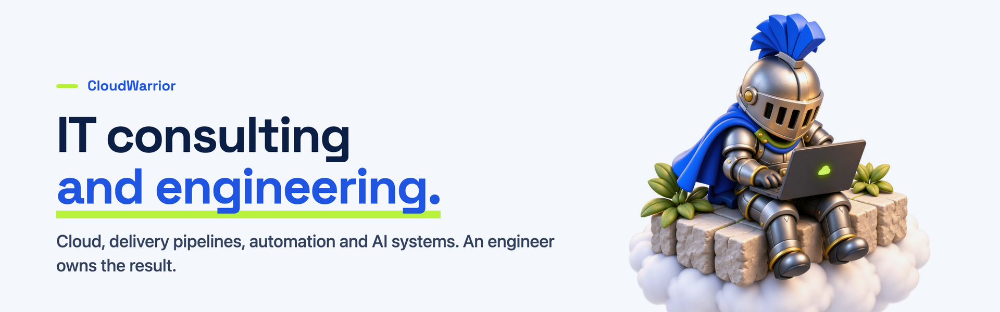

  

### What we do

| | |
|---|---|
| **Cloud and delivery** | Kubernetes, release pipelines, infrastructure as code, cost and reliability |
| **Automation** | Integrations and workflows with logged failure paths |
| **AI systems** | Agents and language features that ship, with an engineer approving what reaches production |
| **Delivery sprints** | Scope, success criteria and handover agreed before building |

### Free working material

- [Readiness checklist](https://cloudwarrior.io/checklist/): 24 questions about recovery, releases, monitoring, cost and access
- [Automation map](https://cloudwarrior.io/automation-map/): a worksheet for recurring tasks
- [Sprint brief](https://cloudwarrior.io/sprint-brief/): what to settle before ordering delivery

### Contact

[cloudwarrior.io](https://cloudwarrior.io) · pat@cloudwarrior.io · remote across the EU
